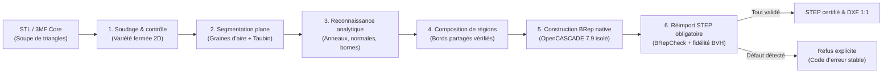

<p align="center">
  
</p>

<h1 align="center">FabSTEP</h1>

<p align="center">
  <strong>Transformez vos maillages STL et 3MF en solides STEP BRep certifiés et éditables — en local, de manière déterministe et sans géométrie inventée.</strong>
</p>

<p align="center">
  <a href="README.md">English</a> · <strong>Français</strong>
</p>

<p align="center">
  <a href="LICENSE"></a>
  
  
  
</p>

---

**FabSTEP** est une application de bureau et en ligne de commande de la famille **FabApps** qui reconstruit de **vraies surfaces CAO analytiques** (solides STEP BRep et profils DXF à l’échelle 1:1) à partir de maillages facettisés **STL** et **3MF Core**.

Contrairement aux convertisseurs habituels qui empilent des milliers de triangles plats ou déforment silencieusement votre pièce par lissage heuristique, FabSTEP **prouve mathématiquement chaque surface reconstruite**, **réimporte systématiquement le fichier STEP avant d’autoriser l’export**, et **n’invente jamais une géométrie absente du maillage**.

**[Télécharger FabSTEP 1.0 pour macOS, Windows et Ubuntu](https://github.com/harry-finch/FabSTEP/releases/tag/v1.0)**. La page de la version indique les modalités d’installation, les prérequis, les sources et les empreintes SHA-256.

---

## Pourquoi FabSTEP ?

Les pièces partagées pour l’impression 3D et la fabrication (Printables, MakerWorld, Thingiverse, exports anciens) sont presque toujours distribuées en **maillages triangulaires STL ou 3MF**. Ouvrir un maillage facettisé dans Fusion, FreeCAD, SolidWorks ou Onshape rend la moindre modification — ajuster un perçage, ajouter un chanfrein, tirer une coupe propre — pénible voire impossible.

FabSTEP répond à ce problème autour de quatre principes stricts :

1. **De vraies surfaces analytiques, pas des facettes déguisées.** Plans, cylindres, cônes, sphères, tores, congés, gorges, révolutions courbes et extrusions profilées sont reconstruits comme de vraies faces CAO sélectionnables, cotables et modifiables.
2. **Certification sans confiance aveugle.** Chaque STEP généré est écrit, **réimporté depuis ses octets par OpenCASCADE 7.9**, puis contrôlé : fermeture du solide, validité BRep, absence d’auto-intersections, volume, dimensions et distance bidirectionnelle au maillage source. Une coque ouverte ou un contrôle échoué n’est *jamais* proposé à l’export.
3. **Rien d’inventé, rien de caché.** FabSTEP ne fabrique jamais un fond de trou absent, ne devine jamais l’unité d’un STL et ne relâche jamais les tolérances en silence. Les zones incertaines restent proprement facettisées tant que vous ne les guidez pas.
4. **100 % local, déterministe et open source.** Aucun envoi cloud, aucun abonnement, aucune boîte noire IA : une même entrée donne toujours le même résultat, sous licence `GPL-3.0-or-later`.

---

## Fonctionnalités principales

### Reconstruction analytique automatique
En mode **Automatique**, FabSTEP analyse le maillage et reconstruit toutes les familles géométriques prouvées, tout en conservant les zones ambiguës en facettes propres :

- **Plans** — y compris la récupération des plans fragmentés par la quantification `f32` des STL binaires, grâce à un amorçage par aire décroissante et des normales lissées de Taubin *en lecture seule* (sans déplacer aucun sommet source).
- **Cylindres et arcs ouverts** — trous traversants, trous borgnes à fond plat, bossages, encoches ouvertes, bandes cylindriques étroites (`15°–30°`), perçages sur plaques inclinées et arbres à perçage transversal.
- **Cônes et chaînes coniques** — chanfreins, fraisures, troncs de cône, chaînes de 2 à 8 cônes alternés ou de même signe (avec ou sans portées cylindriques) et raccords ouverts cylindre–chanfrein.
- **Sphères et tores** — sphères entières, calottes, zones sphériques sans pôle, octants découpés, tores entiers, congés toriques (y compris au-delà de 90°), gorges de poulies et coupes obliques sur tores, cônes et sphères.
- **Formes mécaniques avancées** — perçages sécants (orthogonaux, décentrés ou obliques), congés à rayon variable linéaire, congés de poche (butées droites ou obliques, coins, U, circuits fermés, rayons différents), coins à trois rayons inégaux, lèvres de perçage arrondies sur cylindre, révolutions cubiques et à retour axial, extrusions droites à profil libre cubique, boîtiers arrondis et reliefs bicubiques explicites.

### Atelier 3D interactif
Lorsque vous souhaitez affiner une pièce complexe, l’atelier bureau met à disposition de vrais outils métrologiques :

- **Provenance exacte Source ↔ STEP** — basculez entre la vue **Source** et le **Résultat STEP** ; double-cliquez une face STEP pour sélectionner toute sa paroi prouvée et retrouver exactement ses triangles source (sans approximation).
- **Correction guidée locale** — sélectionnez une zone (clic, Maj-clic ou geste de peinture) et essayez **Auto, Plan, Cylindre, Cône, Tore ou Sphère** localement sans perdre les surfaces déjà reconnues, avec historique complet **Annuler / Rétablir**.
- **Parois similaires et motifs répétés** — après une correction guidée acceptée (par exemple un trou de fixation), FabSTEP repère les parois géométriquement analogues dans la pièce, identifie les **motifs linéaires et circulaires** (comme les trous d’une bride), les prévisualise et n’applique que celles qui passent la preuve complète du solide.
- **Boîte de découpe visuelle 3D** — coupez visuellement la pièce (Source ou Résultat STEP) à l’aide de poignées pour inspecter et sélectionner des cavités internes sans modifier le solide ni l’export.
- **Carte de chaleur d’écart 3D** — colore le solide STEP selon la distance échantillonnée au maillage source, avec légende en millimètres et maximum local par face.
- **Recherche assistée de réglage radial** — compare jusqu’à 7 tolérances radiales autour du seuil courant en revalidant le document entier à chaque essai, pour trouver le réglage le plus propre sur un fichier réel quantifié.

### Export DXF exact à l’échelle 1:1
- **Profils de faces planes** — sélectionnez une face plane STEP et exportez son contour 2D exact en millimètres à l’échelle 1:1 (lignes, arcs, cercles et ellipses exactes — jamais d’approximation polygonale).
- **Coupes 3D du STEP** — déplacez ou inclinez un plan de coupe en 3D et exportez la section CAO exacte (y compris les ellipses de cylindres coupés en biais).
- **Coupes directes du maillage source** — coupez un maillage source validé en DXF polygonal 1:1 même sans reconstruction analytique STEP.

### 3MF Core multi-corps et gros STL denses
- **Préservation multi-corps** — jusqu’à **32 corps distincts** en STL ou **3MF Core**, en conservant les unités déclarées et les placements 3D dans un STEP multi-racines. Contacts, chevauchements et imbrications sont refusés explicitement (aucune fusion silencieuse ni export partiel).
- **Helper isolé pour gros STL** — le mode ordinaire traite jusqu’à **100 000 triangles** ; sur accord explicite, un STL binaire de **100 001 à 600 000 triangles** est confié au processus séparé `fabstep-worker`, annulable à tout moment et borné (4 Gio de mémoire échantillonnée / 30 minutes).

---

## Précision mesurée et résultats concrets

Toutes les valeurs ci-dessous proviennent des campagnes automatisées et des réimports indépendants dans FreeCAD consignés dans [docs/VALIDATION.md](docs/VALIDATION.md) :

| Pièce témoin | Maillage source | STEP reconstruit | Volume / Référence | Fidélité bidirectionnelle (Source ↔ STEP) |
| :--- | ---: | :--- | :--- | :--- |
| **Pièce mécanique multi-familles** (cône + sphère + tore) | 8 211 faces facettisées (STL) | **19 faces analytiques** (12 plans, 4 cyl, 1 cône, 1 sphère, 1 tore) | `54 445,2780 mm³` vs `54 445,2780 mm³` CAO réf. (`< 0,0001 mm³`) | Vérifié dans FreeCAD, tangences conservées |
| **Bloc à perçages sécants + congé longitudinal** | 1 878 triangles | **10 faces** (6 plans, 4 cylindres) | `5 733,4661 mm³` | `0,0036 / 0,0037 mm` |
| **Lèvre torique à coupe oblique (15°)** | 2 275 triangles | **5 faces** (3 plans, 1 cylindre, 1 tore) | `1 273,7067 mm³` | `≤ 0,0379 / 0,0397 mm` (budget `0,05 mm`) |
| **Arbre percé transversalement (Ø20 / Ø4,8 décalé)** | 644 triangles | **4 faces** (2 plans, 2 cylindres) | `4 686,7712 mm³` | `0,0090 / 0,0090 mm` |
| **Arbre étagé à révolution cubique avec retour axial** | 14 178 triangles | **5 faces** (2 plans, 2 cyl, 1 révolution) | `2 541,1558 mm³` | Sous le budget de `0,05 mm` |
| **Coin à 3 congés de rayons inégaux** (2 / 2,5 / 3 mm) | 2 densités | **10 faces** (6 plans, 3 cyl, 1 carreau de coin) | `3 144,3793 mm³` | `≤ 0,0205 mm` |
| **Arbre percé à lèvre arrondie** | 1 770 triangles | **5 faces** (2 plans, 2 cyl, 1 lèvre B-spline) | `5 167,0289 mm³` | `0,0311 mm` |
| **Rampe torique dense (helper isolé)** | 194 694 triangles | **442 faces** (1 tore + plans fusionnés + raccords) | `93,5368 mm³` | `0,0047 / 0,0047 mm` |

FabSTEP est également testé en continu sur un **corpus mécanique public reproductible de 24 maillages** ([fixtures/recognition_corpus/baseline.json](fixtures/recognition_corpus/baseline.json)) et plus de **1 100 tests automatisés** (Rust, C++/OCCT, Tauri, TypeScript/Three.js et Python).

---

## Comment ça fonctionne (sous le capot)

FabSTEP sépare strictement la géométrie pure (`fabstep-core`, sans entrées/sorties, calcul déterministe en `f64`), le noyau CAO natif C++ (`fabstep-cad`, OpenCASCADE 7.9) et le vérificateur indépendant (`fabstep-verify`) :



### 1. Soudage topologique et assainissement strict
Un fichier STL n’est qu’une liste de triangles indépendants sans connectivité ni unité. FabSTEP convertit les coordonnées en millimètres `f64` selon votre unité explicite (ou celle déclarée dans le 3MF Core), soude les sommets coïncidents à `1e-6 mm` près (en comptant chaque déplacement), sépare les corps indépendants, vérifie que chaque corps est une variété fermée orientable, et refuse tout contact, chevauchement ou imbrication entre corps.

### 2. Segmentation plane résistante au bruit de quantification
Les STL binaires stockent leurs coordonnées en flottant 32 bits (`f32`), ce qui introduit un léger effet d’escalier capable de casser une face plane en dizaines de micro-triangles. FabSTEP fait croître les régions planes à partir des plus grands triangles d’abord et, en cas de fragmentation, estime des **normales lissées par filtre de Taubin en lecture seule** sur une copie temporaire pour stabiliser le regroupement *sans jamais déplacer un seul sommet source*.

### 3. Reconnaissance analytique multi-familles et borne d’erreur composée
Plutôt que d’ajuster aveuglément des courbes sur un nuage de points, FabSTEP s’appuie sur des **témoins géométriques structurels** présents dans le maillage :
- **Anneaux de frontière et sections** : ils révèlent les cylindres coaxiaux, les cônes, les chaînes de chanfreins et les profils de révolution (circulaires, toriques ou cubiques).
- **Champs de normales pondérés par l’aire** (sphère de Gauss) : ils découvrent les bandes cylindriques/coniques/sphériques étroites, les directions d’extrusion et les motifs linéaires ou circulaires de perçages, même quand les anneaux complets sont interrompus.
- **Borne géométrique composée** : pour chaque surface candidate, FabSTEP calcule une borne supérieure qui additionne le déplacement de soudage, le résidu radial d’ajustement et la **flèche des cordes** (l’écart géométrique entre un triangle plat du maillage et la surface courbe qu’il approxime). Si cette borne dépasse le budget demandé (`0,05 mm` par défaut), la surface est refusée.

### 4. Composition sûre et propriété locale des triangles
Lorsque plusieurs formes coexistent sur une même pièce (par exemple des perçages sécants à côté d’un congé extérieur, ou des tores bordés par des plans fusionnés), FabSTEP maintient une **attribution exclusive de chaque triangle** et un graphe d’adjacence aux **arêtes partagées vérifiées**. Toute revendication concurrente est arbitrée de façon déterministe — ou repliée proprement en facettes — pour garantir qu’aucune surface ne déchire le solide.

### 5. Construction BRep native isolée
Seule la crate `fabstep-cad` dialogue avec C++ et **OpenCASCADE 7.9**. Les paramètres analytiques et contours vérifiés traversent une frontière FFI C stricte ; OCCT construit les surfaces exactes (`Plane`, `Cylinder`, `Cone`, `Sphere`, `Torus`, `SurfaceOfRevolution`, `SurfaceOfLinearExtrusion`, B-splines rationnelles), les coud en un solide BRep étanche et vérifie la cohérence entre courbes 3D et traces paramétriques (p-curves).

### 6. Réimport STEP obligatoire et audit de fidélité BVH bidirectionnel
FabSTEP ne fait jamais confiance à un solide tant qu’il n’a pas survécu au cycle complet d’écriture/relecture :
1. Le solide est sérialisé en octets STEP.
2. Ces octets exacts sont **réimportés de zéro** par OCCT.
3. FabSTEP vérifie la fermeture topologique, `BRepCheck`, l’absence d’auto-intersections, le nombre exact de faces, le volume, la boîte englobante et la provenance face ↔ triangles.
4. `fabstep-verify` maille le STEP réimporté et mesure les **distances échantillonnées dans les deux sens** (`Source → STEP` et `STEP → Source`) via une hiérarchie de boîtes englobantes (BVH) ordonnée par courbe de Morton. Ce n’est qu’après réussite de tous ces contrôles que **Exporter STEP** devient actif.

---

## Périmètre assumé et limites

- **Solide BRep, pas d’historique paramétrique :** un fichier STEP contient des surfaces mathématiques exactes et leur topologie, pas un arbre d’esquisses éditable.
- **Maillages mécaniques, pas de scans 3D organiques bruités :** FabSTEP vise les maillages fermés issus de CAO (STL / 3MF Core). Les coques ouvertes, auto-intersections et scans photogrammétriques bruités sont refusés explicitement plutôt que bricolés en silence.
- **3MF Core uniquement :** les références multi-modèles de l’extension 3MF Production (fréquentes dans certains projets de slicers) sont refusées explicitement.
- **Plateformes.** macOS 26 ou ultérieur sur Apple Silicon (signature ad hoc), Windows x64 (ZIP portable, WebView2) et Ubuntu 26.04 amd64 (paquet Debian). Le mode gros STL avec moteur isolé est disponible sur macOS.

---

## Démarrage rapide

### Prérequis
- **Rust** `1.88+`
- Compilateur **C++17** (Xcode Command Line Tools sur macOS)
- **Node.js** compatible Vite 8 (validé avec Node 26)
- SDK **OpenCASCADE 7.9.x** (`brew install opencascade` sur macOS, ou définir `OCCT_ROOT` vers un dossier contenant `include/opencascade/` et `lib/`)

### Construire et lancer l’application bureau (macOS)

```sh
brew install opencascade
npm --prefix ui ci
sh scripts/build-macos-dev.sh
```

Le script compile séparément l’application bureau et le helper optimisé `fabstep-worker` (profil release), puis assemble `artifacts/FabSTEP.app`.

Pour développer l’interface Svelte 5 et le bureau Tauri ensemble (port **5181**) :

```sh
npm --prefix ui run desktop:dev
```

> Note : l’interface ouverte seule dans le navigateur permet de prévisualiser un STL ; l’aperçu 3MF et la conversion native STEP/DXF nécessitent le moteur Tauri.

### Ligne de commande (`fabstep-cli`)

```sh
# Analyser la topologie et les composantes d’un maillage (rapport JSON)
cargo run -p fabstep-cli -- check fixtures/cube.stl --unit mm --json

# Reconstruction analytique automatique (recommandé)
cargo run -p fabstep-cli -- convert fixtures/inclined_plate_hole.stl -o /tmp/plate.step --unit mm --mode auto --json

# Modes explicites stricts (planar, cylinders, primitives, surfaces)
cargo run -p fabstep-cli -- convert fixtures/m2b_boss_blind.stl -o /tmp/boss.step --mode cylinders --max-deviation 0.05
cargo run -p fabstep-cli -- convert fixtures/m5d_ring_torus.stl -o /tmp/torus.step --mode surfaces --json

# 3MF Core multi-corps (utilise automatiquement l’unité déclarée)
cargo run -p fabstep-cli -- convert fixtures/m3_instances.3mf -o /tmp/bodies.step --mode auto --json
```

Options principales : `--mode <planar|cylinders|primitives|surfaces|auto>` (défaut `planar`), `--unit <mm|cm|m|in>` (STL uniquement), `--fit <mm>` (défaut `0.00001`), `--max-deviation <mm>` (défaut `0.05`), `--weld <mm>` (défaut `0.000001`), `--plane <mm>` (défaut `0.000001`), `--force` (autoriser l’écrasement d’une sortie existante), `--json`.

### Vérifier et tester

```sh
sh scripts/check.sh
```

Contrôles individuels :
```sh
cargo fmt --all -- --check
cargo test --workspace --offline
cargo clippy --workspace --all-targets --offline -- -D warnings
cargo check --manifest-path crates/fabstep-desktop/Cargo.toml --offline
npm --prefix ui run test && npm --prefix ui run check && npm --prefix ui run build
```

---

## Organisation du dépôt

| Dossier | Rôle |
| :--- | :--- |
| `crates/fabstep-core` | Moteur pur et déterministe de géométrie `f64` et reconnaissance analytique (aucune IO, aucun OCCT) |
| `crates/fabstep-import` | Lecteurs bornés STL (ASCII/binaire) et 3MF Core avec gestion des unités et placements |
| `crates/fabstep-cad` | Pont FFI C++17 / OpenCASCADE 7.9 isolé : construction BRep, écriture/relecture STEP et DXF 1:1 |
| `crates/fabstep-verify` | Vérificateur indépendant de fidélité bidirectionnelle BVH (maillage ↔ STEP) et carte d’écart |
| `crates/fabstep-app` | Orchestration applicative, correction guidée, parois similaires/motifs, recherche de tolérances |
| `crates/fabstep-cli` | Interface en ligne de commande (`check`, `convert`) et banc du corpus de reconnaissance |
| `crates/fabstep-desktop` | Backend bureau Tauri 2, permissions locales strictes, supervision du helper (hors workspace) |
| `crates/fabstep-worker` | Helper isolé `large-stl` (100k–600k triangles, plafonds mémoire et durée) |
| `ui/` | Atelier 3D interactif Svelte 5 + TypeScript + Three.js (FR/EN, thèmes sombre/clair) |
| `fixtures/` | Suites de test STL/3MF reproductibles et corpus mécanique public de 24 maillages |
| `docs/` | Décisions d’architecture (`adr/`), [VALIDATION.md](docs/VALIDATION.md), [RELEASE.md](docs/RELEASE.md), [POST_V1_RESEARCH.md](docs/POST_V1_RESEARCH.md) |

---

## Documentation et licence

- [STATUS.md](STATUS.md) — État vérifié courant et statut de la branche active
- [ROADMAP.md](ROADMAP.md) — Feuille de route générée depuis `roadmap/` (suivie dans FabBoard)
- [ARCHITECTURE.md](ARCHITECTURE.md) — Frontières architecturales et flux de données
- [docs/VALIDATION.md](docs/VALIDATION.md) — Journal complet des preuves, mesures et réimports FreeCAD

Distribué sous licence **[GPL-3.0-or-later](LICENSE)**. Projet de l’écosystème **FabApps**.
