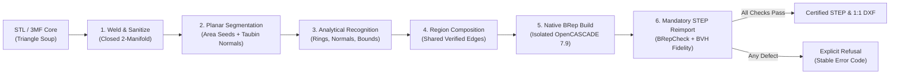

<p align="center">
  
</p>

<h1 align="center">FabSTEP</h1>

<p align="center">
  <strong>Convert STL and 3MF meshes into certified, editable BRep STEP solids — locally, deterministically, and without guesswork.</strong>
</p>

<p align="center">
  <strong>English</strong> · <a href="README.fr.md">Français</a>
</p>

<p align="center">
  <a href="LICENSE"></a>
  
  
  
</p>

---

**FabSTEP** is a local desktop and CLI tool in the **FabApps** family that reconstructs **true analytical CAD geometry** (STEP BRep solids and 1:1 DXF profiles) from faceted **STL** and **3MF Core** meshes.

Unlike typical mesh-to-STEP converters that either dump thousands of flat triangles or silently deform your part with heuristic smoothing, FabSTEP **proves every reconstructed surface mathematically**, **reimports every STEP file before letting you export it**, and **never invents geometry that is not in the mesh**.

**[Download FabSTEP 1.0 for macOS, Windows and Ubuntu](https://github.com/harry-finch/FabSTEP/releases/tag/v1.0)**. The release page lists installation instructions, runtime requirements, sources and SHA-256 checksums.

---

## Why FabSTEP?

3D-printed and shared CAD models (Printables, MakerWorld, Thingiverse, legacy exports) are almost always distributed as **STL or 3MF triangle meshes**. Opening a faceted mesh in Fusion, FreeCAD, SolidWorks, or Onshape makes even trivial edits—resizing a bolt hole, adding a chamfer, taking a clean cross-section—painful or impossible.

FabSTEP bridges that gap with four core principles:

1. **Real analytical surfaces, not disguised facets.** Planes, cylinders, cones, spheres, tori, fillets, grooves, revolved curves, and curved extrusions are reconstructed as native CAD surfaces you can select, dimension, and edit in any CAD package.
2. **Zero-trust certification.** Every generated STEP is written, **reimported from disk through OpenCASCADE 7.9**, and checked for watertightness, BRep validity, self-intersection, volume, bounding box, and bidirectional distance to the source mesh. An open shell or failed check is *never* presented as a valid export.
3. **Nothing invented, nothing hidden.** FabSTEP never fabricates a missing hole bottom, never guesses an STL unit, and never silently relaxes tolerances. Uncertain zones stay cleanly faceted until you choose to guide them.
4. **100% local, deterministic, open source.** No cloud upload, no subscription, no black-box AI guesses—identical inputs produce identical results, under `GPL-3.0-or-later`.

---

## Key Features

### Automatic Analytical Reconstruction
In **Auto** mode, FabSTEP analyzes the mesh and reconstructs every provable surface family while keeping ambiguous regions safely faceted:

- **Planes** — including recovery of planes fragmented by `f32` STL quantization, using large-area seeding and read-only Taubin normal stabilization without moving source vertices.
- **Cylinders & Open Arcs** — through-holes, blind holes with flat bottoms, bosses, open notches, narrow cylindrical bands (`15°–30°`), inclined plate holes, and shafts with transversal bores.
- **Cones & Conical Chains** — chamfers, countersinks, frustums, alternating or same-sign chains of 2 to 8 cones (with or without cylindrical lands), and open cylinder–chamfer transitions.
- **Spheres & Tori** — full spheres, spherical caps, pole-less spherical zones, cut spherical octants, full tori, toroidal fillets (including arcs > 90°), pulley grooves, and oblique toroidal/conical/spherical cuts.
- **Advanced Mechanical Features** — intersecting cross-drills (orthogonal, offset, or oblique), variable-radius linear fillets, pocket fillets (stops, corners, U-chains, closed loops, unequal radii), 3-radius unequal corners, curved-edge rolling-bore lips, cubic and returning-axis revolutions, freeform cubic extrusions, uniform rounded boxes, and explicit bicubic height patches.

### Interactive 3D Workshop
When a complex part needs fine-grained control, the desktop workshop gives you direct metrological tools:

- **Exact Source ↔ STEP Provenance** — switch between **Source** and **STEP Result** views; double-click any STEP face to highlight its exact wall and trace the exact source triangles that produced it.
- **Guided Local Refinement** — select a region (click, Shift-click, or click-and-drag paint) and test **Auto, Plane, Cylinder, Cone, Torus, or Sphere** locally without losing already-recognized surfaces, with full **Undo / Redo** session history.
- **Similar Walls & Pattern Propagation** — after accepting a guided correction (for example, one mounting hole), FabSTEP finds geometrically analogous walls across the part, detects **linear and circular patterns** (such as bolt circles on a flange), previews them, and applies only those that pass full solid proof.
- **3D Visual Clipping Box (*Box View*)** — slice visually through the Source or STEP model with draggable handles to inspect and select internal cavities without altering the geometry or export.
- **3D Deviation Heatmap** — color the reconstructed STEP by sampled distance to the source mesh with a millimeter legend and per-face local maxima.
- **Assisted Radial Tolerance Search** — automatically compares up to 7 radial fit tolerances around the current setting, revalidating the entire document on each trial, so you can pick the cleanest proven fit on quantized real-world files.

### Exact 1:1 DXF Export
- **Planar Face Profiles** — select any planar STEP face and export its exact 2D profile in millimeters at 1:1 scale (lines, arcs, circles, and exact ellipses—never polygonal approximations).
- **3D STEP Cross-Sections** — position or tilt a section plane interactively in 3D and export exact 1:1 CAD sections (including oblique cylinder ellipses).
- **Direct Source Mesh Sections** — slice validated source meshes directly to polygonal DXF even if analytical STEP reconstruction is not needed.

### Multi-Body 3MF Core & Dense STL Support
- **Multi-Body Preservation** — up to **32 separate bodies** in STL or **3MF Core**, preserving declared units and 3D placements in multi-root STEP output. Contacts, overlaps, or nested bodies are explicitly refused (never silently merged or partially exported).
- **Opt-In Dense STL Worker** — ordinary mode handles up to **100,000 triangles**; binary STLs from **100,001 to 600,000 triangles** can be processed on explicit consent via an isolated `fabstep-worker` subprocess with instant cancellation and strict resource caps (4 GiB sampled RAM / 30 min timeout).

---

## Measured Precision & Real-World Benchmarks

Every figure below is taken directly from automated runs and independent FreeCAD reimports recorded in [docs/VALIDATION.md](docs/VALIDATION.md):

| Benchmark Part | Source Mesh | Reconstructed STEP | Volume / Reference | Bidirectional Fidelity (Source ↔ STEP) |
| :--- | ---: | :--- | :--- | :--- |
| **Multi-family mechanical part** (cone + sphere + torus) | 8,211 faceted faces (STL) | **19 analytical faces** (12 planes, 4 cyl, 1 cone, 1 sphere, 1 torus) | `54,445.2780 mm³` vs `54,445.2780 mm³` ref CAD (`< 0.0001 mm³` diff) | Verified in FreeCAD, tangencies preserved |
| **Cross-drilled block + longitudinal fillet** | 1,878 triangles | **10 faces** (6 planes, 4 cylinders) | `5,733.4661 mm³` | `0.0036 / 0.0037 mm` |
| **Oblique toroidal lip (15° cut)** | 2,275 triangles | **5 faces** (3 planes, 1 cylinder, 1 torus) | `1,273.7067 mm³` | `≤ 0.0379 / 0.0397 mm` (budget `0.05 mm`) |
| **Drilled shaft (Ø20 / Ø4.8 offset)** | 644 triangles | **4 faces** (2 planes, 2 cylinders) | `4,686.7712 mm³` | `0.0090 / 0.0090 mm` |
| **Stepped shaft with returning cubic revolution** | 14,178 triangles | **5 faces** (2 planes, 2 cyl, 1 revolution) | `2,541.1558 mm³` | Within `0.05 mm` budget |
| **3-radius unequal corner block** (2 / 2.5 / 3 mm) | 2 densities | **10 faces** (6 planes, 3 cyl, 1 blend patch) | `3,144.3793 mm³` | `≤ 0.0205 mm` |
| **Rolling-bore shaft (filleted cross-hole lip)** | 1,770 triangles | **5 faces** (2 planes, 2 cyl, 1 B-spline lip) | `5,167.0289 mm³` | `0.0311 mm` |
| **Dense toroidal ramp (isolated worker)** | 194,694 triangles | **442 faces** (1 torus + merged planes + collars) | `93.5368 mm³` | `0.0047 / 0.0047 mm` |

FabSTEP is also continuously regression-tested on a reproducible **24-mesh public mechanical corpus** ([fixtures/recognition_corpus/baseline.json](fixtures/recognition_corpus/baseline.json)) and **1,100+ automated tests** across Rust, C++/OCCT, Tauri, TypeScript/Three.js, and Python.

---

## How It Works (Under the Hood)

FabSTEP separates pure geometry (`fabstep-core`, zero I/O, deterministic `f64` math) from the native C++ CAD kernel (`fabstep-cad`, OpenCASCADE 7.9) and the independent verification engine (`fabstep-verify`):



### 1. Topological Welding & Strict Sanitization
An STL file is just an unordered list of triangles with no connectivity and no declared unit. FabSTEP converts coordinates to `f64` millimeters using your explicit unit (or the unit declared in 3MF Core), welds matching vertices within `1e-6 mm` (counting every single displacement), splits disconnected bodies, checks that every body is a closed, orientable 2-manifold, and verifies that separate bodies never touch, overlap, or nest inside each other.

### 2. Noise-Resistant Planar Segmentation
Real-world binary STLs store coordinates in 32-bit floating point (`f32`), which introduces tiny stair-stepping quantization noise that can shatter a single flat face into dozens of micro-triangles. FabSTEP grows planar regions starting from the largest-area triangles first and—when fragmentation is detected—computes **read-only Taubin-smoothed normals** on a temporary copy to stabilize region grouping *without ever moving a single source vertex*.

### 3. Multi-Family Analytical Recognition & Composed Error Bounds
Instead of blindly fitting curves to point clouds, FabSTEP extracts **structural geometric witnesses** from the mesh:
- **Boundary rings & cross-sections** reveal coaxial cylinders, cones, chains of chamfers, and revolved profiles (circular, toroidal, or cubic).
- **Area-weighted normal fields** (Gaussian sphere analysis) discover narrow cylindrical/conical/spherical bands, extrusion directions, and linear/circular hole patterns even when complete rings are interrupted.
- **Exact composed bounds** — for every candidate surface, FabSTEP computes an upper bound that adds weld displacement, radial fit residual, and **chord sagitta** (the geometric distance between a flat mesh triangle and the curved analytical surface it approximates). If the composed bound exceeds the document budget (default `0.05 mm`), the candidate is rejected.

### 4. Safe Composition & Local Ownership
When multiple geometric features coexist on the same part (for example, intersecting drill holes alongside an external fillet, or toroidal fillets bordering merged planes), FabSTEP tracks **strict triangle ownership** and **verified shared edges** in a region adjacency structure. Conflicting claims are resolved deterministically—or fall back cleanly to facets—so two surfaces never double-claim or tear the solid.

### 5. Isolated Native BRep Construction
Only `fabstep-cad` talks to C++ and **OpenCASCADE 7.9**. Analytical parameters and verified boundary curves cross a strict C FFI boundary, where OCCT builds exact surfaces (`Plane`, `Cylinder`, `Cone`, `Sphere`, `Torus`, `SurfaceOfRevolution`, `SurfaceOfLinearExtrusion`, rational B-splines), sews them into a watertight BRep solid, and checks 3D curves against surface p-curves.

### 6. Mandatory STEP Reimport & Bidirectional BVH Fidelity Audit
FabSTEP never trusts a freshly constructed solid until it survives round-trip serialization:
1. The solid is exported to STEP bytes.
2. Those exact STEP bytes are **reimported from scratch** through OCCT.
3. FabSTEP verifies topological closure, `BRepCheck`, self-intersections, exact face count, volume, bounding box, and face-to-source provenance.
4. `fabstep-verify` tessellates the reimported STEP and measures **bidirectional sampled distances** (`Source → STEP` and `STEP → Source`) using a Morton-ordered Bounding Volume Hierarchy (BVH). Only if every check passes does **Export STEP** become available.

---

## Honest Scope & Limitations

- **BRep solid, not parametric history:** A STEP file contains exact mathematical surfaces and topology, not an editable CAD sketch/feature tree.
- **Mechanical meshes, not noisy organic 3D scans:** FabSTEP targets closed CAD-origin meshes (STL / 3MF Core). Open shells, self-intersecting meshes, and noisy photogrammetry scans are refused explicitly rather than silently patched.
- **3MF Core only:** Multi-model references from the 3MF Production extension (common in some slicer project files) are explicitly refused.
- **Platforms.** macOS 26+ on Apple Silicon (ad hoc signature), Windows x64 (portable ZIP, WebView2) and Ubuntu 26.04 amd64 (Debian package). The isolated large-STL helper is available on macOS.

---

## Getting Started

### Prerequisites
- **Rust** `1.88+`
- **C++17** compiler (Xcode Command Line Tools on macOS)
- **Node.js** compatible with Vite 8 (validated with Node 26)
- **OpenCASCADE 7.9.x** SDK (`brew install opencascade` on macOS, or set `OCCT_ROOT` to a prefix containing `include/opencascade/` and `lib/`)

### Build & Run the Desktop App (macOS)

```sh
brew install opencascade
npm --prefix ui ci
sh scripts/build-macos-dev.sh
```

This builds both the desktop app and the isolated `fabstep-worker` release helper into `artifacts/FabSTEP.app`.

To run the Svelte 5 frontend and Tauri desktop app together in development mode (port **5181**):

```sh
npm --prefix ui run desktop:dev
```

> Note: Opening the UI alone in a browser only previews STL files; 3MF preview and native STEP/DXF reconstruction require the Tauri desktop runtime.

### Command-Line Interface (`fabstep-cli`)

```sh
# Inspect mesh topology and components (JSON report)
cargo run -p fabstep-cli -- check fixtures/cube.stl --unit mm --json

# Automatic analytical reconstruction (recommended)
cargo run -p fabstep-cli -- convert fixtures/inclined_plate_hole.stl -o /tmp/plate.step --unit mm --mode auto --json

# Explicit modes (planar, cylinders, primitives, surfaces)
cargo run -p fabstep-cli -- convert fixtures/m2b_boss_blind.stl -o /tmp/boss.step --mode cylinders --max-deviation 0.05
cargo run -p fabstep-cli -- convert fixtures/m5d_ring_torus.stl -o /tmp/torus.step --mode surfaces --json

# Multi-body 3MF Core (uses declared unit automatically)
cargo run -p fabstep-cli -- convert fixtures/m3_instances.3mf -o /tmp/bodies.step --mode auto --json
```

Key CLI flags: `--mode <planar|cylinders|primitives|surfaces|auto>` (default `planar`), `--unit <mm|cm|m|in>` (STL only), `--fit <mm>` (default `0.00001`), `--max-deviation <mm>` (default `0.05`), `--weld <mm>` (default `0.000001`), `--plane <mm>` (default `0.000001`), `--force` (allow overwriting an existing file), `--json`.

### Run the Verification Suite

```sh
sh scripts/check.sh
```

Individual checks:
```sh
cargo fmt --all -- --check
cargo test --workspace --offline
cargo clippy --workspace --all-targets --offline -- -D warnings
cargo check --manifest-path crates/fabstep-desktop/Cargo.toml --offline
npm --prefix ui run test && npm --prefix ui run check && npm --prefix ui run build
```

---

## Repository Organization

| Path | Role |
| :--- | :--- |
| `crates/fabstep-core` | Pure, deterministic `f64` geometry & analytical recognition engine (no I/O, no OCCT) |
| `crates/fabstep-import` | Bounded STL (ASCII/binary) & 3MF Core parsers with unit and placement handling |
| `crates/fabstep-cad` | Isolated C++17 / OpenCASCADE 7.9 FFI bridge for BRep construction, STEP I/O, and 1:1 DXF |
| `crates/fabstep-verify` | Independent bidirectional mesh ↔ STEP BVH fidelity & deviation heatmap engine |
| `crates/fabstep-app` | Application orchestration, guided refinement, similar-wall/pattern discovery, parameter search |
| `crates/fabstep-cli` | Command-line interface (`check`, `convert`) and recognition corpus benchmark runner |
| `crates/fabstep-desktop` | Tauri 2 desktop backend, strict local permissions, worker supervision (out of workspace) |
| `crates/fabstep-worker` | Isolated `large-stl` subprocess helper (100k–600k triangles, bounded RAM & timeout) |
| `ui/` | Svelte 5 + TypeScript + Three.js interactive 3D workshop (French & English, dark/light themes) |
| `fixtures/` | Reproducible STL/3MF test suites & 24-mesh public mechanical recognition corpus |
| `docs/` | Architecture Decision Records (`adr/`), [VALIDATION.md](docs/VALIDATION.md), [RELEASE.md](docs/RELEASE.md), [POST_V1_RESEARCH.md](docs/POST_V1_RESEARCH.md) |

---

## Documentation & License

- [STATUS.md](STATUS.md) — Current verified state and active branch status
- [ROADMAP.md](ROADMAP.md) — Generated roadmap from `roadmap/` (managed via FabBoard)
- [ARCHITECTURE.md](ARCHITECTURE.md) — System boundaries and data flow
- [docs/VALIDATION.md](docs/VALIDATION.md) — Complete validation log, benchmarks, and FreeCAD reimport proofs

Licensed under **[GPL-3.0-or-later](LICENSE)**. Part of the **FabApps** ecosystem.
